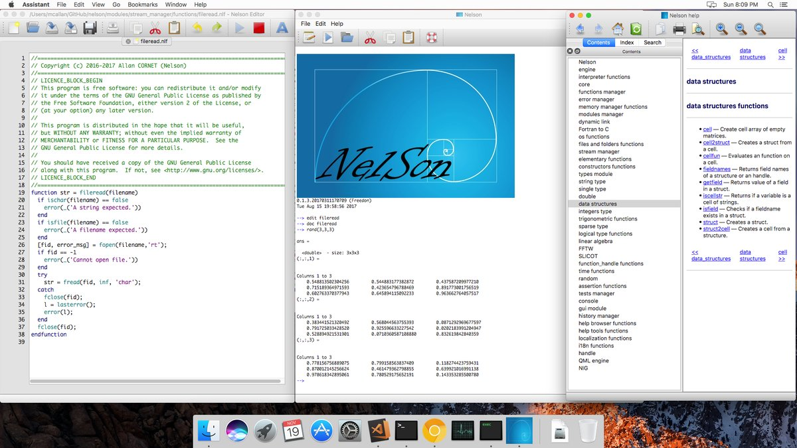
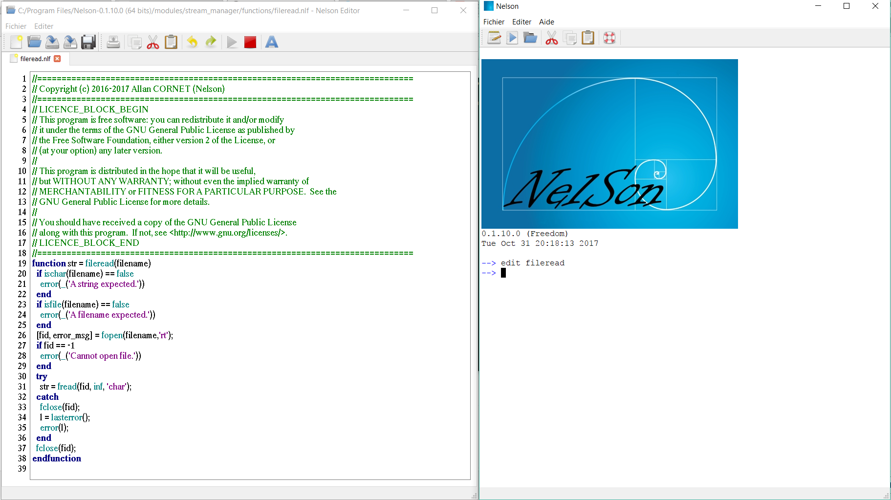
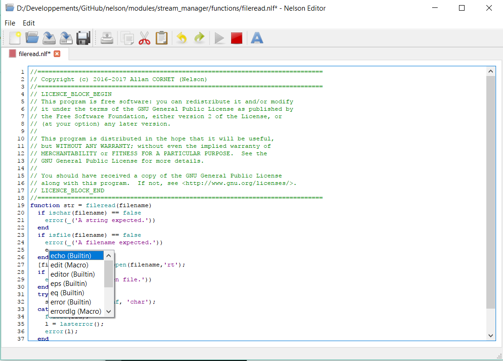

# Embedded Nelson code editor

The code editor is integrated into Nelson.
It enables easy script edition with autocompletion, smart indentation, statement executing possibility and to manage multiple instances.

Code editor provides the following editing functionality for writing and modifying Nelson files:

- Cut, copy, and paste,
- Undo and Redo,
- Syntax highlighting,
  
- Auto indentation,
- Text completion,
  
- Drag & Drop files.

[Back to features](features.md)
