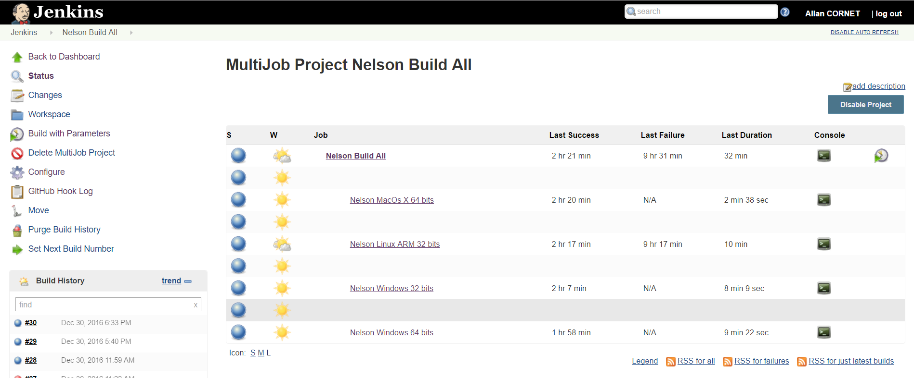
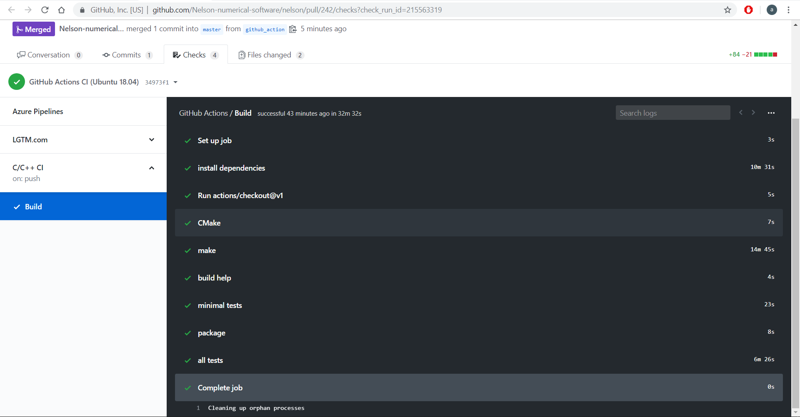
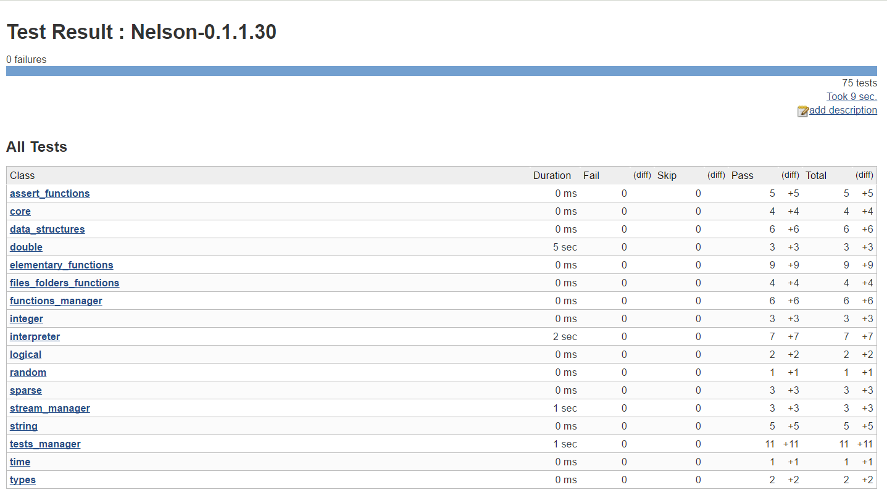
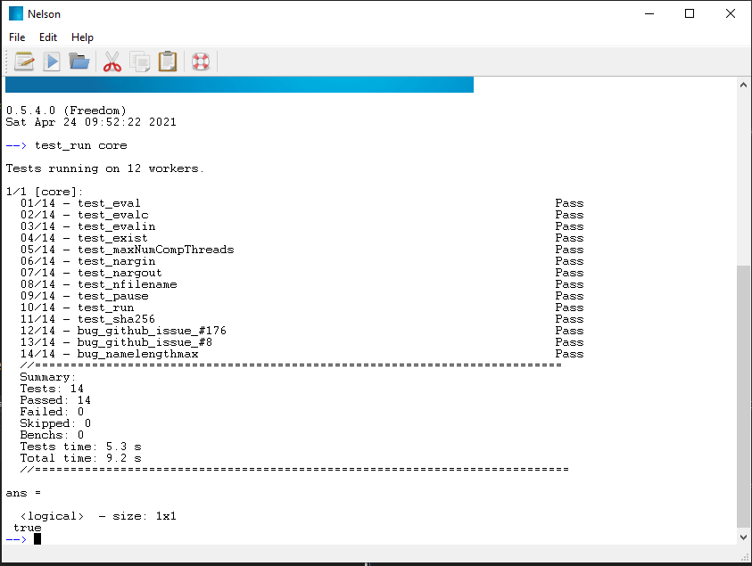

# Development

Each commit into Nelson Github repository starts a continuous integration process based on Jenkins:

Github actions used to check each commits on Windows, Linux and MacOs:

[Github actions CI](https://github.com/nelson-lang/nelson/actions)

Each build process executes all unitary tests and non-regression tests under all supported platforms:

[Back to features](features.md)
