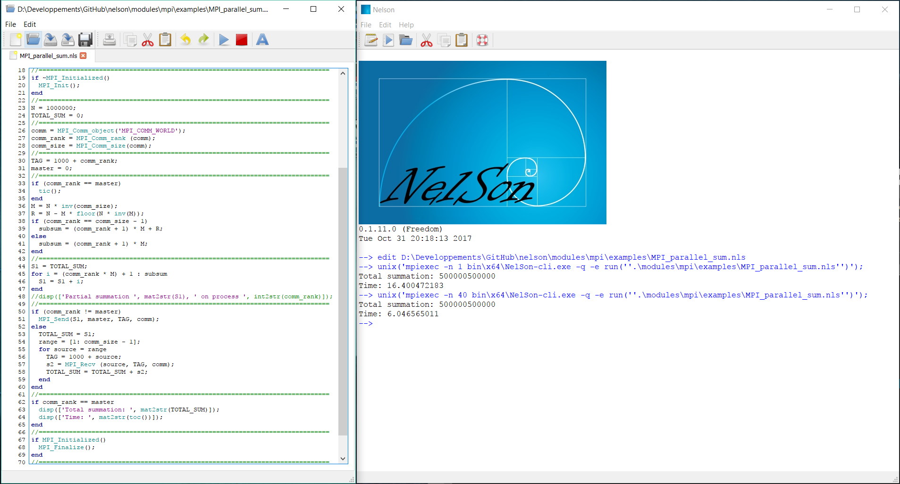
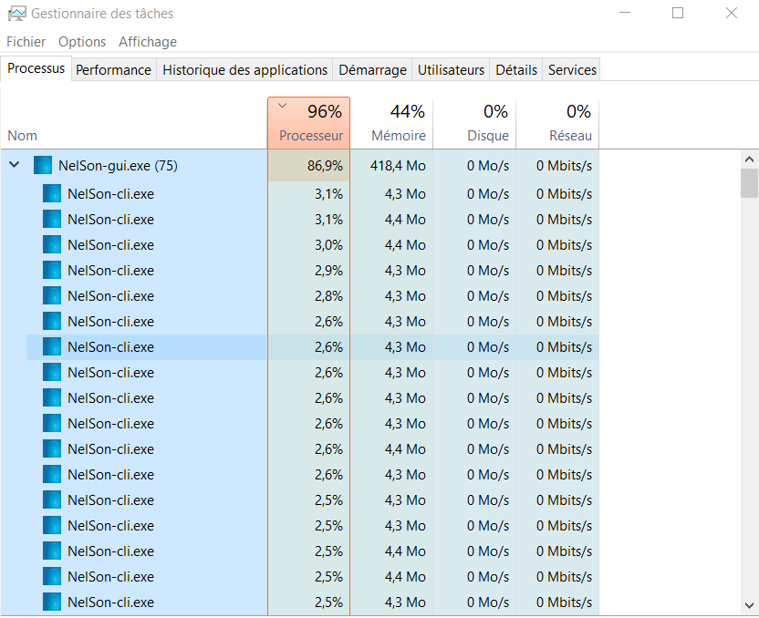

# Message Passing Interface

Distributed Computing with MPI:

- [mpiexec](https://nelson-lang.github.io/nelson-gitbook/releases/en_US/latest/mpi/mpiexec.html) : Run an MPI script.
- [MPI_Allreduce](https://nelson-lang.github.io/nelson-gitbook/releases/en_US/latest/mpi/MPI_Allreduce.html) : Combines values from all processes and distributes the result back to all processes.
- [MPI_Barrier](https://nelson-lang.github.io/nelson-gitbook/releases/en_US/latest/mpi/MPI_Barrier.html) : Blocks until all processes in the communicator have reached this routine.
- [MPI_Bcast](https://nelson-lang.github.io/nelson-gitbook/releases/en_US/latest/mpi/MPI_Bcast.html) : Broadcasts a message from the process with rank "root" to all other processes of the communicator
- [MPI_Comm_delete](https://nelson-lang.github.io/nelson-gitbook/releases/en_US/latest/mpi/MPI_Comm_delete.html) : Removes MPI_Comm object.
- [MPI_Comm_get_name](https://nelson-lang.github.io/nelson-gitbook/releases/en_US/latest/mpi/MPI_Comm_get_name.html) : Return the print name from the communicator.
- [MPI_Comm_object](https://nelson-lang.github.io/nelson-gitbook/releases/en_US/latest/mpi/MPI_Comm_object.html) : Creates MPI_Comm object.
- [MPI_Comm_rank](https://nelson-lang.github.io/nelson-gitbook/releases/en_US/latest/mpi/MPI_Comm_rank.html) : Determines the rank of the calling process in the communicator.
- [MPI_Comm_size](https://nelson-lang.github.io/nelson-gitbook/releases/en_US/latest/mpi/MPI_Comm_size.html) : Determines the size of the group associated with a communicator.
- [MPI_Comm_split](https://nelson-lang.github.io/nelson-gitbook/releases/en_US/latest/mpi/MPI_Comm_split.html) : Partitions the group that is associated with the specified communicator into a specified number of disjoint subgroups.
- [MPI_Comm_used](https://nelson-lang.github.io/nelson-gitbook/releases/en_US/latest/mpi/MPI_Comm_used.html) : Returns list of current used MPI_Comm handle.
- [MPI examples](https://nelson-lang.github.io/nelson-gitbook/releases/en_US/latest/mpi/MPI_examples.html) : Some Nelson MPI examples.
- [MPI_Finalize](https://nelson-lang.github.io/nelson-gitbook/releases/en_US/latest/mpi/MPI_Finalize.html) : Terminate the MPI execution environment.
- [MPI_Get_library_version](https://nelson-lang.github.io/nelson-gitbook/releases/en_US/latest/mpi/MPI_Get_library_version.html) : Return the version number of MPI library.
- [MPI_Get_processor_name](https://nelson-lang.github.io/nelson-gitbook/releases/en_US/latest/mpi/MPI_Get_processor_name.html) : Gets the name of the processor.
- [MPI_Get_version](https://nelson-lang.github.io/nelson-gitbook/releases/en_US/latest/mpi/MPI_Get_version.html) : Return the version number of MPI.
- [MPI_Init](https://nelson-lang.github.io/nelson-gitbook/releases/en_US/latest/mpi/MPI_Init.html) : Initialize the MPI execution environment.
- [MPI_Initialized](https://nelson-lang.github.io/nelson-gitbook/releases/en_US/latest/mpi/MPI_Initialized.html) : Indicates whether MPI_Init has been called.
- [MPI_Iprobe](https://nelson-lang.github.io/nelson-gitbook/releases/en_US/latest/mpi/MPI_Iprobe.html) : Nonblocking test for a message.
- [MPI overview](https://nelson-lang.github.io/nelson-gitbook/releases/en_US/latest/mpi/MPI_overview.html) : Access to MPI features from Nelson.
- [MPI_Probe](https://nelson-lang.github.io/nelson-gitbook/releases/en_US/latest/mpi/MPI_Probe.html) : Blocking test for a message.
- [MPI_Recv](https://nelson-lang.github.io/nelson-gitbook/releases/en_US/latest/mpi/MPI_Recv.html) : Blocking receive for a message.
- [MPI_Reduce](https://nelson-lang.github.io/nelson-gitbook/releases/en_US/latest/mpi/MPI_Reduce.html) : Reduces values on all processes to a single value.
- [MPI_Send](https://nelson-lang.github.io/nelson-gitbook/releases/en_US/latest/mpi/MPI_Send.html) : Performs a blocking send.

Example: Sum on distributed computing:

[Source MPI sum example](https://github.com/nelson-lang/nelson/blob/master/modules/mpi/examples/MPI_parallel_sum.m)

[Back to features](features.md)
