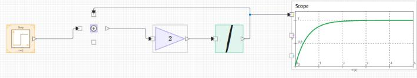
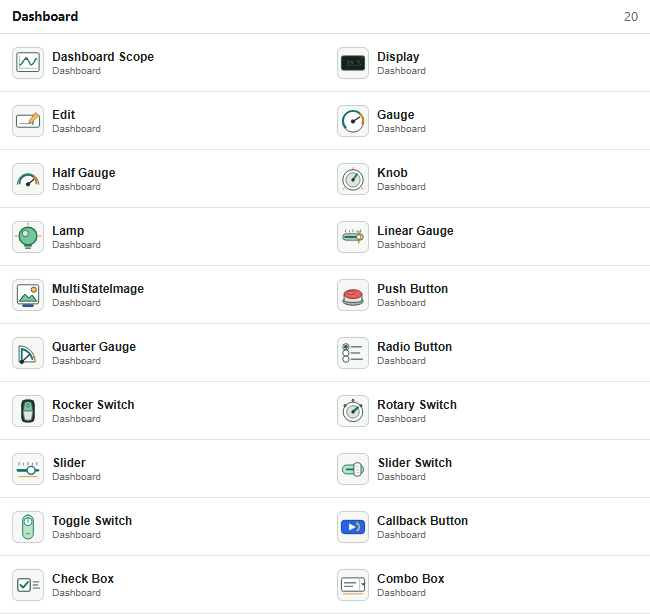

# NFlow <span class="pill pill-beta">beta</span>

**Build models visually, then generate code you can read and maintain.**

NFlow is Nelson's visual environment for building, simulating, and generating code from
block-diagram models. You assemble a model from a palette of blocks, wire up signal flows
or physical networks, simulate it, and inspect signals on scopes and dashboards. When the
model is ready, NFlow turns it into clean, portable source code that you own: embed it in
your own application or firmware, or run it on its own.



## Build

- A palette of blocks: sources, mathematics, logic, continuous and discrete dynamics,
  signal routing, and sinks.
- **Causal** signal-flow modelling and **acausal** physical (Modelica-style) networks on
  one canvas.
- Subsystems and masks for structuring large models.
- A **scripted model API** (`new_system`, `add_block`, `add_line`, `set_param`, and
  others) for building and editing models from code.

## Simulate

- A shared numerical engine with **fixed-step and variable-step solvers** (ode1, ode4,
  and ode45), plus a DAE backend for acausal networks.
- Event and zero-crossing handling, and algebraic-loop solving.
- Live **scopes** and interactive **dashboards**, including gauges, knobs, switches,
  lamps, and displays.



## Generate C and Rust

Any supported model generates to **C and Rust** that build and run outside Nelson and match
the interpreter to near machine precision. Models that use features which are not yet
available for code generation (the variable-step and DAE solvers, FMU and Modelica blocks,
or Nelson-function blocks) are rejected cleanly, with typed messages naming the offending
block, rather than producing silently incorrect code.

The generated code has **no runtime dependency**. A model becomes a small, reusable API: a
`ModelState` struct and `nflow_init`, `nflow_step`, and `nflow_terminate` functions, with one
input field per external source and one output field per sink. Code generation is therefore
**not only for standalone programs**: you call `nflow_step` from your own application,
library, or real-time control loop. A runnable `main` (a CSV writer) and the build files
(`CMakeLists.txt` for C, `Cargo.toml` for Rust) are emitted too, but they are optional.

### Rust that runs on bare metal (`no_std`)

The generated Rust core is a **`#![no_std]` crate**: it needs no operating system and no
allocator. Its maths go through the `libm` crate, so it compiles for any target that provides
libm, including **bare-metal microcontrollers, an RTOS, and WebAssembly**. The crate is split
in two: `lib.rs` is the `no_std` model core you deploy, and an optional `main.rs` is a
standard host runner that adds file I/O and command-line arguments. For a microcontroller,
the deployable artefact is the library.

The supported solvers are the fixed-step **ode1** (Euler) and **ode4** (Runge-Kutta 4) and
the embedded adaptive **ode45** (Dormand-Prince 5(4)), with zero-crossing surfaces localised
by bisection exactly as in the simulator. Every generated model is verified locally: it is
compiled, run, and compared against the simulator sample for sample.

```matlab
% Generate C (the default), then no_std Rust, from a model file.
nflow_codegenerate(model, destination, true, 'C');
nflow_codegenerate(model, destination, true, 'rust');

% Core only, to embed in your own project (no main, no build files).
nflow_codegenerate(model, destination, false, 'rust');
```

## Interoperate

- **FMI and FMU** import and export for co-simulation.
- A stable, versioned `.nflow` model format, with guaranteed forward-readability for
  published models.

---

NFlow currently ships as a public **beta**. The model format is frozen at beta level, and
a final 1.0.0 release will add golden-file coverage in continuous integration.

See [what else is new in 2.0](whats-new.md), or
[download Nelson](https://github.com/nelson-lang/nelson/releases).

[Back to home](index.html)
