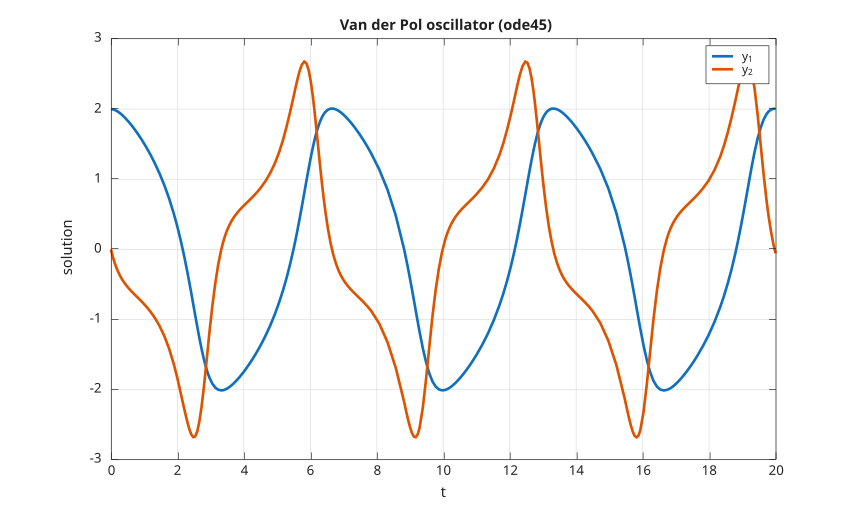

# ODE solvers

**Integrate differential equations with the solver names and calling conventions you already
know.**

Nelson's **ode_solvers** module provides time integration for explicit, stiff, and implicit
problems, together with delay and boundary-value equations. The solvers, their options, and
their result objects follow the same interface as the standard array language, so existing
differential-equation scripts run unchanged: the same `ode45`, `ode15s`, `odeset`, `deval`,
and event handling, with the same calling conventions.

## A first example

Solve `y' = -y` with `y(0) = 1` over the interval `[0, 1]`:

```matlab
[t, y] = ode45(@(t, y) -y, [0 1], 1);
y(end)   % 0.367879, which is exp(-1)
```

## A system of equations

The Van der Pol oscillator is a classic two-state system. The right-hand side returns a
column vector, one entry per state:

```matlab
mu  = 1;
vdp = @(t, y) [y(2); mu * (1 - y(1)^2) * y(2) - y(1)];
[t, Y] = ode45(vdp, [0 20], [2; 0]);
plot(t, Y);
```

<figure class="figure-hero" markdown="0">
  
  <figcaption>The two states of the Van der Pol oscillator, integrated with <code>ode45</code>.</figcaption>
</figure>

## Choose the right solver

The familiar family of solvers covers the usual regimes, and they are interchangeable
because they share one calling convention:

- **Non-stiff**: `ode23`, `ode45`, `ode78`, `ode89`, `ode113`.
- **Stiff**: `ode15s`, `ode23s`, `ode23t`, `ode23tb`.
- **Fully implicit** `F(t, y, y') = 0`: `ode15i`.

On a stiff problem a non-stiff solver is forced into very small steps, while a stiff solver
stays efficient. The Van der Pol oscillator with `mu = 1000` is stiff, and `ode15s`
integrates it over a long interval in a few hundred steps:

```matlab
mu  = 1000;
vdp = @(t, y) [y(2); mu * (1 - y(1)^2) * y(2) - y(1)];
[t, Y] = ode15s(vdp, [0 3000], [2; 0]);
```

## Options, events, and dense output

- `odeset` builds an options structure, with `RelTol`, `AbsTol`, `Events`, `Mass`,
  `Jacobian`, and the other familiar fields.
- **Events** stop or record the integration when a condition is met, such as a bouncing ball
  crossing the ground.
- **Dense output**: call a solver with a single output to get a solution object, then
  evaluate it anywhere with `deval`, or continue it past its final time with `odextend`.

```matlab
sol = ode45(vdp, [0 20], [2; 0]);
yi  = deval(sol, 10);    % interpolate the solution at t = 10
```

## Beyond initial value problems

- **Delay equations**: `dde23`, `ddesd`, and `ddensd`.
- **Boundary value problems**: `bvp4c` and `bvp5c`, with `bvpinit` and `bvpset`.
- **Mass matrices** and a **Jacobian** can be supplied through `odeset` for implicit and
  differential-algebraic systems.

## An object-oriented workflow

The `ode` object groups the equation, initial condition, options, and chosen solver into a
single problem that you can solve, re-solve, and inspect as a results object. When the
optional **SUNDIALS** backend is built, the object workflow can also select the **CVODES**
and **IDAS** solvers.

---

Read the reference for
[`ode45`](https://nelson-lang.github.io/nelson-gitbook/releases/en_US/latest/ode_solvers/ode45.html),
[`ode15s`](https://nelson-lang.github.io/nelson-gitbook/releases/en_US/latest/ode_solvers/ode15s.html),
[`odeset`](https://nelson-lang.github.io/nelson-gitbook/releases/en_US/latest/ode_solvers/odeset.html),
[`deval`](https://nelson-lang.github.io/nelson-gitbook/releases/en_US/latest/ode_solvers/deval.html),
[`bvp4c`](https://nelson-lang.github.io/nelson-gitbook/releases/en_US/latest/ode_solvers/bvp4c.html),
and [`dde23`](https://nelson-lang.github.io/nelson-gitbook/releases/en_US/latest/ode_solvers/dde23.html).

[Back to home](index.html)
