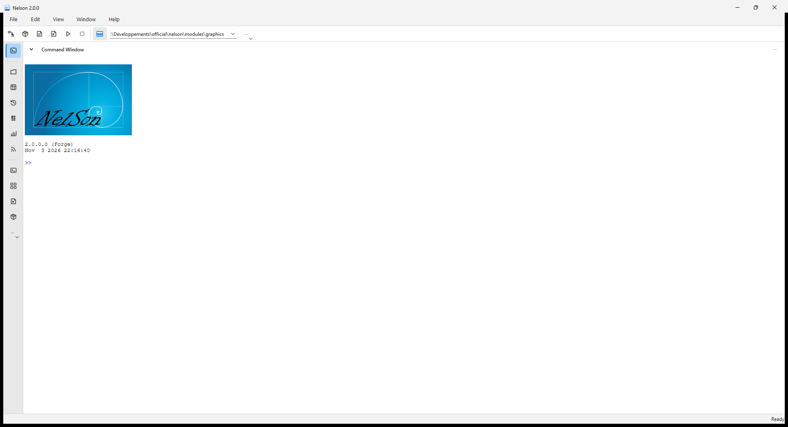
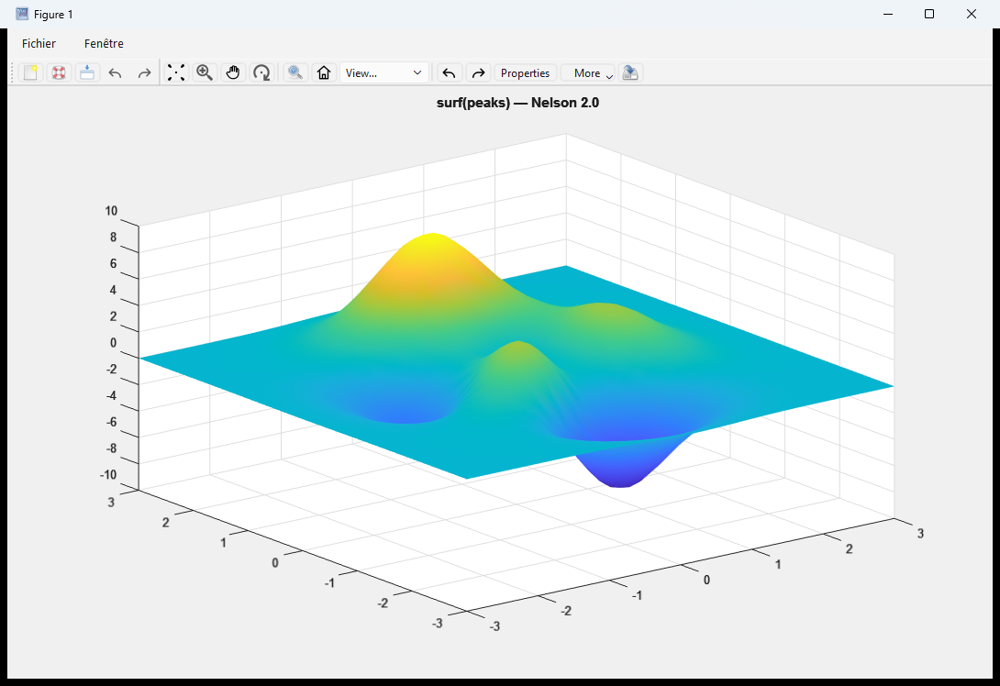
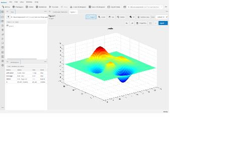

# Nelson in action

Nelson 2.0 ships with a modern, dockable desktop. It brings together a command window,
workspace and history browsers, a variable editor, a code editor with debugging, and
figure windows, all running on the fast new engine.

*The Nelson 2.0 desktop, with a dockable command window, workspace, history, and tools in one window.*

Graphics open in their own interactive figure windows, rendered by the rebuilt
backend-agnostic engine:

*An interactive `surf(peaks)` figure. You can pan, zoom, rotate, and edit properties live.*

## The same desktop, in your browser

Nelson 2.0 also runs as a [**web desktop**](web-desktop.md), with the same engine and
interface and nothing to install. A WebAssembly build runs Nelson entirely client-side.

*The web desktop running live in a browser.*

## Every platform

Nelson runs natively on **Windows**, **macOS**, and **Linux**, including **ARM** boards and
embedded systems, and in the browser through **WebAssembly**. The interface and the results
are consistent across all of them.

You can [download Nelson](https://github.com/nelson-lang/nelson/releases), browse the
[plot gallery](plot_gallery.md), or read about [the 2.0 release](whats-new.md).

---

[Back to home](index.html)
