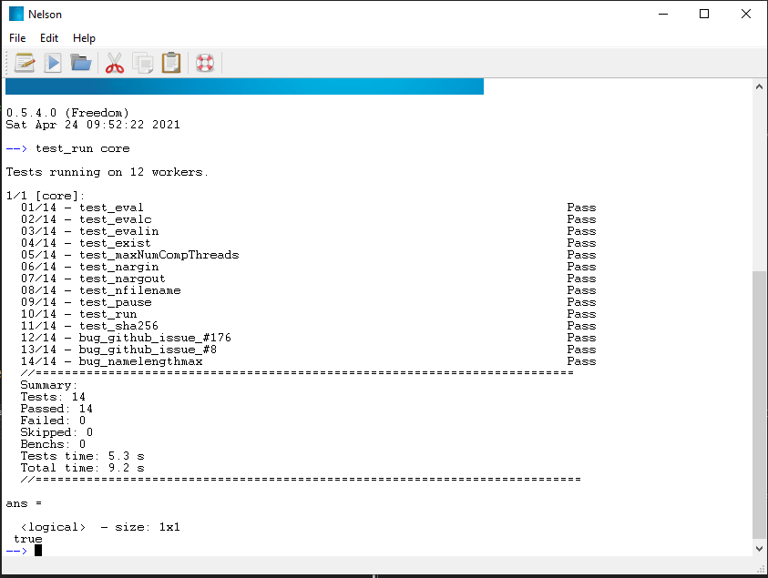
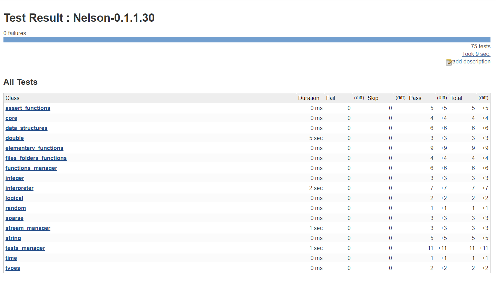

# Tests engine

Validate your algorithm using Nelson dedicated [functions](https://nelson-lang.github.io/nelson-gitbook/releases/en_US/latest/index.html?open=./assert_functions/index.html).

Since v0.5.4, tests are executed on multiple workers on all platforms supported (linux, mac and windows).

Export the test results under the xUnit reports format.

[xUnit xml format](https://github.com/nelson-lang/nelson/releases/download/v0.1.1/tests-0.1.1.30-win-x86-64.xml)

[Back to features](features.md)
