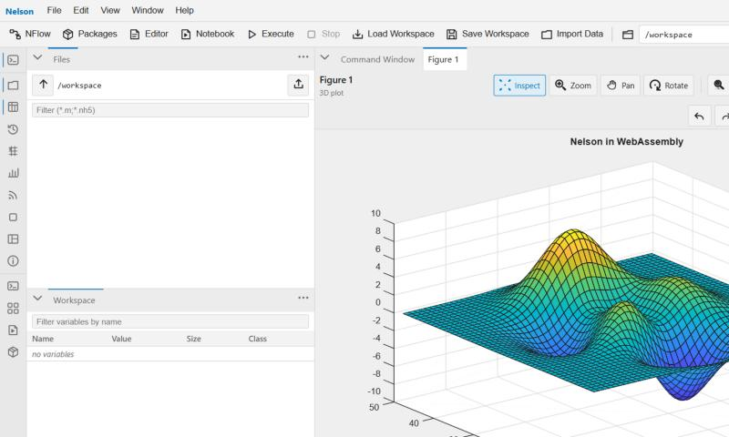
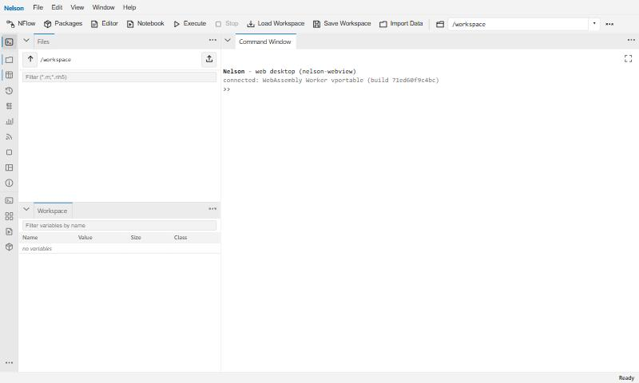
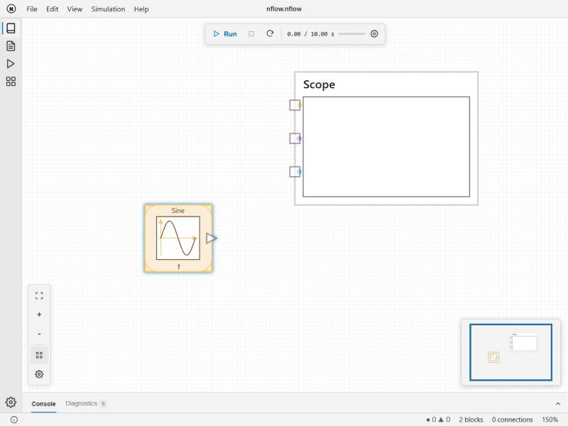
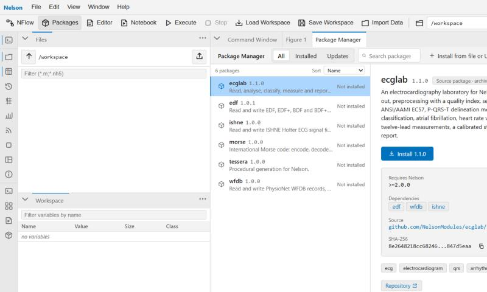

# Web desktop

**The full Nelson desktop, running in your browser.**

Nelson 2.0 introduces a complete web desktop: a browser-based equivalent of the native Qt
desktop, built so that the same engine and graphics run in the browser. It reuses the
existing engine and offers a dockable workspace with the features you would expect from the
desktop application.

<figure class="figure-hero" markdown="0">
  
  <figcaption>The Nelson web desktop running live in the browser with WebAssembly: command window, file and workspace browsers, and a dockable 3-D figure.</figcaption>
</figure>

## What is inside

- A **command window** with history, Tab completion, and Ctrl+C.
- **Workspace, History, and File browsers.**
- An editable **variable editor** for arrays, structs, cells, and tables, with
  Excel-style paste and undo and redo.
- A **code editor** with breakpoints and debugging.
- **Dockable figure windows**, where graphics render as server-streamed images or
  natively through WebGL.
- Integrated executable **notebooks**.

## It runs client-side with WebAssembly

A separate **WebAssembly** build compiles Nelson itself so that it runs entirely in the
browser, with no server round-trip. A new `iswasm()` function, alongside `ispc`, `ismac`,
and `isunix`, lets scripts, packages, and demos adapt to the browser environment.

Nearly all of Nelson's features are available in this build, including visual modelling with
[NFlow](nflow.md). You can run it directly in your browser at
[nelson-everywhere](https://nelson-lang.github.io/nelson-everywhere/).

  <figure>
    
    <figcaption>The desktop connected to a WebAssembly worker, running entirely in the browser.</figcaption>
  </figure>
  <figure>
    
    <figcaption>NFlow, the visual modelling editor, with a Sine source and a Scope.</figcaption>
  </figure>
  <figure>
    
    <figcaption>Browsing and installing packages from the package manager.</figcaption>
  </figure>

## The same plots everywhere

Because the graphics engine is backend-agnostic, the plots you build render identically on
the native desktop, headless, in the web desktop, and in WebAssembly.

---

The web desktop is enabled with a build option, and the native desktop remains the default.

See [what else is new in 2.0](whats-new.md), or
[download Nelson](https://github.com/nelson-lang/nelson/releases).

[Back to home](index.html)
