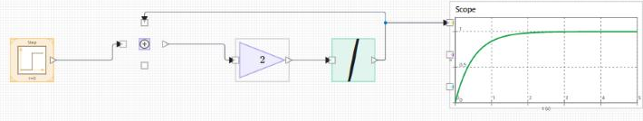
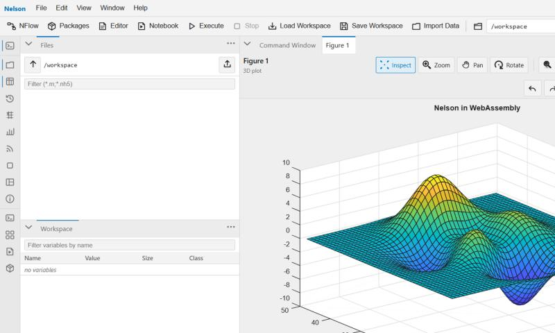
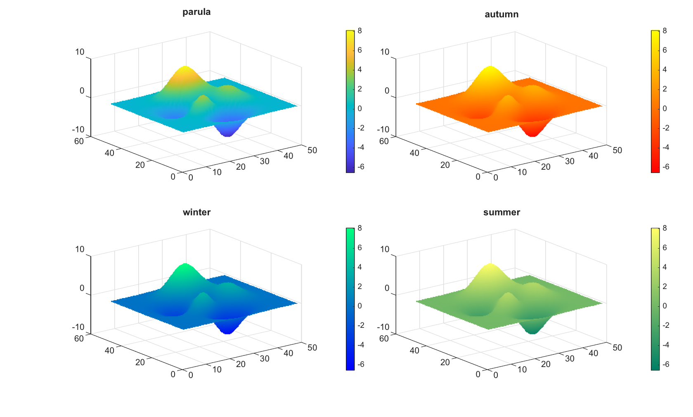

# What's new in Nelson 2.0

Nelson 2.0 is a major release. It is faster on the inside and considerably broader on the
outside. Existing scripts run more quickly, larger projects gain real structure, and
several new ways of working arrive: visual modelling, a browser-based desktop, and a
modern data-analysis toolkit.

Some 2.0 capabilities ship as **beta**, and are marked as such below.

---

## A faster engine

Your code now runs on a **bytecode virtual machine** with compiled chunks and dedicated
fast paths for real and complex scalars. The results are the same, and the execution is
noticeably quicker. Nelson holds itself to a strict internal performance target, and a
broad optimisation pass turned dozens of common operations from quadratic to linear, so
workloads that previously took tens of seconds now finish in a fraction of that time.

## Object-oriented programming with classdef

You can write value and handle classes with inheritance, Constant, Dependent, and private
properties, static and instance methods, operator overloading, events, enumerations,
metaclass introspection, and `arguments`-block validation inside methods. Compatibility
has been checked extensively, so most existing object-oriented code runs unchanged.

## NFlow: visual modelling with code generation *(beta)*

[**NFlow**](nflow.md) is Nelson's visual block-diagram editor and simulator. You assemble
a model from a palette of blocks, connect causal signal flows or acausal physical
networks, and run it on a solver engine with live scopes and dashboards. When the model is
ready, NFlow generates clean, standalone **C and Rust** that build and run on their own and
match the simulation to machine precision. It also supports **FMI and FMU** for
co-simulation.

<figure class="figure-hero" markdown="0">
  
  <figcaption>An NFlow model: blocks connected by signal flows, ready to simulate and to generate C or Rust.</figcaption>
</figure>

## Web desktop and WebAssembly

[**The web desktop**](web-desktop.md) brings the command window, code editor, debugger,
variable editor, and dockable figures to your browser, using the same engine, with nothing
to install. A separate **WebAssembly** build compiles Nelson itself so that it runs
client-side in the browser.

<figure class="figure-hero" markdown="0">
  
  <figcaption>The web desktop running in a browser with WebAssembly, with the command window and a docked 3-D figure.</figcaption>
</figure>

## Modern data analysis

- **Tables** and **timetables** for labelled, mixed-type data, with the full workflow:
  variable and row names, `addvars`, `movevars`, and `renamevars`, set operations,
  sorting, `summary`, and CSV and Parquet I/O.
- **datetime** and **duration** with sub-second precision, time zones, Excel-time
  conversion, and genuinely time-aware plot axes.
- **categorical** arrays, with reference-matched grouped display and categorical plots.

## Graphics, rebuilt

The graphics engine was re-architected around a backend-agnostic core, so the same plots
render on the native desktop, headless, in the browser, and in WebAssembly. A thorough
compatibility pass brought exact tick placement, fonts, and colours, real axis-ruler and
title objects, physically based surface lighting, and new chart types, from `yyaxis` and
`polaraxes` to heatmaps and streamlines.

<figure class="figure-hero" markdown="0">
  
  <figcaption>One surface, four colormaps: the same plot renders identically on the desktop, headless, in the browser, and in WebAssembly.</figcaption>
</figure>

## More building blocks

- Full **sparse-matrix** support across operations.
- An **image-processing** module, and a **NetCDF** reader and writer.
- A **Julia** interface alongside the existing Python bridge.
- A reworked, searchable **help system** with multi-format export (PDF, HTML, and DOCX)
  and a French translation.

---

Ready to try it? [**Download Nelson**](https://github.com/nelson-lang/nelson/releases).
See [all features](features.md) or read the
[changelog](https://github.com/nelson-lang/nelson/blob/master/CHANGELOG.md).

[Back to home](index.html)
